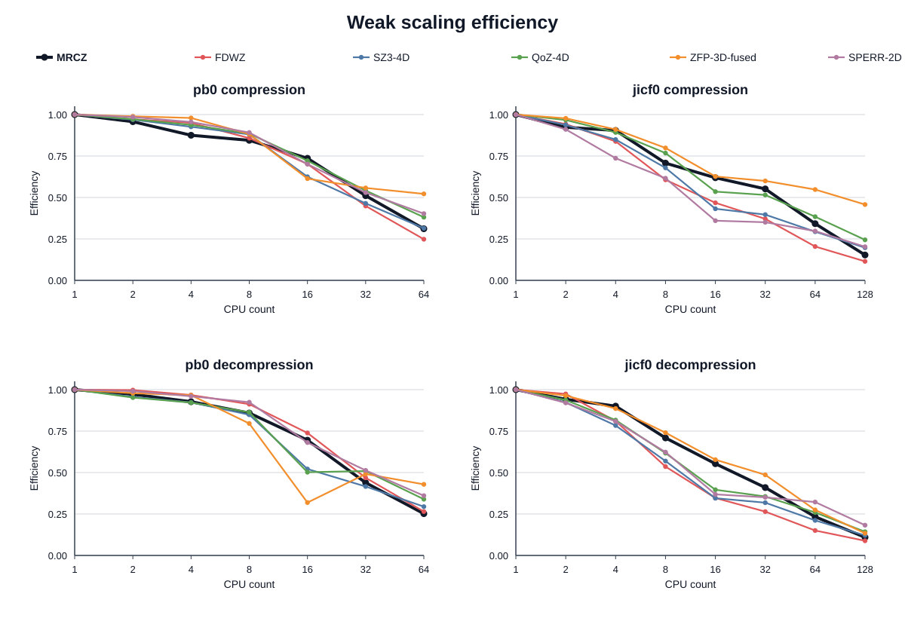

# MRCZ

## 脚本列表

| 脚本 | 功能 |
|---|---|
| `t1_start_c_code.py` | 构建并运行C++压缩与解压程序，执行主要rate-distortion和throughput实验，并将各field的结果写入CSV。数据集、方法、field和error bound可通过文件配置或`MRCZ_T1_*`环境变量选择。 |
| `t2_find_three_irregular_elements.py` | 在NekRS数据中寻找三个两两共享面的非平面element，并生成element、内部节点层和reference element的交互式三维图。 |
| `t3_test_interpolation_prediction.py` | 抽取NekRS element、寻找共享面邻居，比较跨公共面预测与element内部预测的误差，并生成相对误差ECDF。 |
| `t4_plot_data_coeff_err_distribution.py` | 比较原始field、变换系数和误差的概率分布，输出三联直方图；运行前需要准备对应的`_coeff`和`_err`二进制文件。 |
| `t5_start_weak_scaling.py` | 在固定目标PSNR下执行单节点weak scaling实验，结果写入`results/weak_scaling/`中的raw、summary和quality CSV。 |
| `generate_mfem_and_nektar_data.py` | 构建MFEM ex0/ex1和Nektar++ FieldConvert，并生成项目使用的两个MFEM样例及Nektar++ cylinder VTU数据。 |

正式weak scaling可分别使用`run_t5_weak_pb0.sbatch`和`run_t5_weak_jicf.sbatch`提交到Slurm。

`py_funcs/`中的辅助功能：

| 文件 | 功能 |
|---|---|
| `read_nekrs_header.py` | 解析NekRS field文件头，返回字节序、数据精度、element shape、element数量和field信息。 |
| `interpolate_br_at_psnr.py` | 整理BR--PSNR曲线，并线性插值得到指定PSNR下的BR。 |
| `plot_weak_scaling.py` | 根据weak scaling summary CSV生成`results/weak_scaling/weak_scaling_efficiency.svg`。 |

## 安装

需要Python 3、CMake、支持C++20和OpenMP的C++编译器。绘图与分析脚本还需要NumPy、SciPy、Matplotlib和Plotly。

克隆项目并初始化submodule：

```bash
git clone --recurse-submodules git@github.com:ZizheJian/mrcz.git
cd mrcz
```

如果项目已经克隆：

```bash
git submodule update --init --recursive
```

创建Python环境：

```bash
python3 -m venv mrcz_env
source mrcz_env/bin/activate
python -m pip install --upgrade pip
python -m pip install numpy scipy matplotlib plotly
```

推荐直接运行`t1_start_c_code.py`。它会依次构建并安装SPERR、MFEM和MRCZ，然后执行当前配置的实验：

```bash
python3 t1_start_c_code.py
```

安装后的可执行文件位于`install/bin/mrcz_compress`和`install/bin/mrcz_decompress`。已有安装或多个实验并行时，可设置`MRCZ_T1_BUILD_BEFORE_TEST=false`跳过重复构建。

如果只想安装而不运行实验，或者需要单独控制CMake配置，也可以手动构建：

```bash
cmake -S third_party/sperr -B build/sperr_build -DCMAKE_INSTALL_PREFIX="$PWD/install/sperr_install" -DBUILD_SHARED_LIBS=OFF
cmake --build build/sperr_build --parallel 8
cmake --install build/sperr_build

cmake -S third_party/mfem -B build/mfem_build -DCMAKE_INSTALL_PREFIX="$PWD/install/mfem_install"
cmake --build build/mfem_build --parallel 8
cmake --install build/mfem_build

cmake -S c_codes -B build -DCMAKE_INSTALL_PREFIX="$PWD/install"
cmake --build build --parallel 8
cmake --install build
```

submodule中提供了三个可直接测试的NekRS小数据：

- `third_party/pySEMTools/examples/data/mixlay0.f00001`
- `third_party/pySEMTools/examples/data/tc_channel0.f00001`
- `third_party/fld_pyutils/demos/data/test0.f00001`

MFEM和Nektar++验证数据可通过以下命令重新生成：

```bash
python3 generate_mfem_and_nektar_data.py
```

脚本生成`build/mfem_build/examples/ex0examples/`、`build/mfem_build/examples/ex1examples/`和`third_party/flow-stability-cylinder/tutorial/base/Cylinder-Base.vtu`。

# 1. 简介

本项目研究高阶有限元与谱元模拟数据的误差有界有损压缩，主要面向NekRS/Nek5000等程序生成的三维物理场，并使用MFEM和Nektar++样例验证数据布局的通用性。此类数据由大量高阶element组成：element之间按非规则网格及拓扑关系组织，而每个element内部的采样点通常位于Gauss--Lobatto--Legendre（GLL）节点上，形成尺寸较小但结构固定的张量积网格。物理场在单个element内部通常较平滑，但跨element的存储顺序、尺度和局部变化可能不连续，因此把数据简单展平或视为普通规则网格会损失可利用的结构。

项目的核心目标是在严格满足逐点误差界限的前提下，同时改善压缩率、压缩与解压吞吐量以及多核扩展性。主要方法MRCZ对每个element进行GLL张量基变换，分别编码变换系数与点值残差，再通过coefficient-major布局、Huffman和Zstd压缩；候选方法FDWZ则直接利用GLL节点距离进行自适应插值预测。两者将与使用官方API和预先固定tensorization方式的通用压缩器进行公平比较，并以rate--distortion、throughput、scaling和端到端传输时间共同决定最终论文定位。

所有进入项目内core backend的方法共用field级外围流程，包括读取数据、计算值域与ABS/REL error bound、选择计算精度以及写入公共bitstream信息。若一个field的最大值和最小值可以由其中点在`abs_eb`内同时重建，公共层会只保存constant flag和该中点，并跳过MRCZ、FDWZ等具体backend；因此constant-field encoding不是任何单个算法的组成部分。官方API baseline使用各压缩器自己的入口，不经过这项公共处理。

项目主入口为`t1_start_c_code.py`，其中定义正式数据集、field、误差界限、方法列表以及结果文件位置。正式CSV保存在对应数据旁边，方法与baseline布局见第5章；本文档后半部分记录投稿IPDPS或DCC之前仍需完成的工作。

# 2. FDWZ核心与优化记录

FDWZ（Fast Distance-Weighted Interpolation-Based Lossy Compressor）借鉴SZ3的多层插值预测框架，但预测范围限制在单个高阶element内，并使用真实GLL节点坐标而不是均匀索引距离。它不是对官方SZ3的简单参数调整，而是项目内为高阶有限元/谱元数据实现的独立预测器。

## 2.1. 核心流程

1. 根据element shape和各维GLL坐标预先构造可由编解码两端确定性复现的预测层、访问顺序、reference位置及插值权重。每个有效维度的两个端点构成初始边界，递归选择最接近物理中点的未编码GLL节点。
2. 每个二维/三维element的4/8个角点直接进行误差有界量化；其余节点按照预测层和维度顺序逐步处理。linear模式使用两个已重建reference按真实GLL距离进行一次插值；cubic模式则根据当前可用的已重建reference数量，自适应使用三次、二次或一次Lagrange插值。
3. 每次预测后立即量化prediction residual，并用量化结果覆盖目标值。后续预测只引用该重建值，因此压缩端与解压端具有完全相同的误差传播路径，并保证逐点误差界限。
4. FDWZ在每个partition内进行确定性的等间隔采样，通常采样128--1024个element，并取各等分区间中点附近的element；当partition不足128个element时使用全部element。随后先从六种维度顺序中选择sample真实压缩大小最小的linear方案，再在相同顺序下比较linear与cubic。选中的方案编号写入该partition的bitstream。
5. 量化整数按照角点及预测层分组。正式FDWZ固定使用当前element shape允许的最大Huffman tree数，最多五棵；每个partition独立建立Huffman tree，将全部Huffman metadata和payload拼接后再压缩为一个Zstd frame。
6. partition之间彼此独立，通过OpenMP并行执行采样、预测、量化、Huffman和Zstd；解压端按相反顺序恢复Huffman符号，并在每个element内依次重建节点。

## 2.2. 角点与初始seed阶段

| 优化或候选方案 | 状态 | 结论 |
|---|---|---|
| 4/8个角点预测为0并直接量化 | **采纳** | 最简单且在五个NekRS数据上最稳定，作为正式seed方案。 |
| 使用前一编号element预测角点 | **放弃** | 依赖编号相邻element具有物理相关性，完整bitstream没有稳定收益。 |
| element内角点Lorenzo、角点均值加deviation及其组合 | **放弃** | 局部角点流偶有改善，但额外符号或后续误差传播抵消了完整BR收益。 |
| 将角点流从element-contiguous转成local-symbol-contiguous | **放弃** | test0、mixlay0和jicf0退化，仅tc_channel0和pb0小幅改善。 |
| 先建立中心、最后向外外插角点 | **放弃** | 角点/中心点预测误差诊断已排除该方向。 |

## 2.3. element内预测与访问顺序阶段

| 优化或候选方案 | 状态 | 结论 |
|---|---|---|
| 按GLL物理中点递归并使用真实GLL距离计算权重 | **采纳** | 比索引中点更符合非均匀GLL节点分布，是正式预测树的基础。 |
| 三维数据中的六种维度顺序 | **采纳为partition级选择** | 不存在跨数据和partition普遍最优的固定顺序，因此由确定性的等间隔sample选择。（SZ3中已有） |
| linear与cubic | **采纳为partition级选择** | 高阶插值在mixlay0、tc_channel0、pb0和部分jicf0上显著降低BR，但会破坏test0的特殊可预测结构，不能全局固定启用。（SZ3中已有） |
| surface-first：按边、面、体及中心向外顺序预测 | **放弃** | 在代表性数据上没有形成rate--distortion优势。 |
| normal-boundary：先建立中心块，再沿法向外插边界 | **放弃** | 五个数据上均被正式物理中点预测树Pareto支配。 |
| 官方SZ3式2幂stride、单原点seed的index-order | **放弃** | 对小element反复支付粗层级远距离预测成本，三个小数据均无优势。 |
| 不预测物理中点，而是预测索引中点 | **放弃** | pb0和jicf0的BR分别增加约8.4%和4.7%，说明物理距离比索引邻近更重要。 |
| element编号方向预测 | **放弃** | 在五个数据上严格优于所有element内方向的点不足约1.1%，加入空间oracle后的总体改善很小。 |
| 真实共享面邻居与坐标匹配预测 | **放弃当前实现方向** | 早期跨公共面实验没有优于element内预测，同时会引入邻居搜索和拓扑metadata成本。 |
| QoZ式GLL预测路径 | **仅保留独立对照** | test0/UZ上的BR明显差于FDWZ，不作为正式优化继续。 |

## 2.4. 量化与residual建模阶段

| 优化或候选方案 | 状态 | 结论 |
|---|---|---|
| 对之后仍会被引用的reference使用更严格EB | **放弃** | 同PSNR下仅mixlay0约有2%收益，其余数据持平或退化，不足以承担选择复杂度。 |
| 每个局部位置学习prediction-residual bias | **放弃** | 单bin峰值和带置信度的稳健宽窗口版本都不能覆盖采样与bias metadata开销，且降低吞吐量。 |
| 根据前面element在线更新预测统计 | **放弃** | 会引入顺序依赖和同步成本，没有进入正式bitstream。 |

## 2.5. QB布局、Huffman与Zstd阶段

| 优化或候选方案 | 状态 | 结论 |
|---|---|---|
| 非角点QB按实际预测访问顺序保存 | **采纳** | 大数据随机段上稳定降低约5%--7% BR，压缩吞吐代价约1%，解压局部性也更好。（SZ3中已有） |
| 非角点QB转置一下，使得element编号维度最快 | **放弃** | pb0和jicf0平均BR分别增加约4.2%和3.5%，跨步访问还显著破坏缓存局部性。 |
| 1--5棵Huffman tree分离角点和不同预测层 | **采纳最大有效tree数** | 大partition上多tree可利用各预测层不同的符号分布；正式FDWZ按shape固定最多五棵，避免额外tree选择逻辑。 |
| 从sample直接选择tree数 | **放弃** | 小sample无法正确摊销tree metadata，tree数与完整partition的最优选择经常不一致。 |
| 按符号数阈值或half/full sample外推tree成本 | **放弃** | regret仍不够稳定；最终固定最大有效tree比自适应规则更简单稳健。 |
| 每个partition的多个Huffman流合并到一个Zstd frame | **采纳** | 保留不同符号分布的Huffman收益，同时让Zstd继续利用整个partition的字节级冗余。 |

## 2.6. 配置采样、并行与实现加速阶段

| 优化或候选方案 | 状态 | 结论 |
|---|---|---|
| partition内确定性的等间隔采样 | **采纳** | 对维度顺序和linear/cubic的holdout选择较稳定，最多采样1024个element，不依赖随机数或随机种子。 |
| 只采样partition连续前缀 | **放弃** | 对非平稳partition代表性不足，曾出现超过100%的holdout regret。 |
| 预计算prediction stencil和GLL权重 | **采纳** | 避免在每个element重复构造预测关系，并保证编解码路径一致。 |
| partition级OpenMP并行 | **采纳** | partition天然独立，无需在element预测树内部增加同步。 |
| 跨element AVX2并行预测与量化 | **放弃正式合并** | 约256 KB tile解决了整partition position-major访问的缓存退化，但float没有收益，double端到端仅约快9%，不足以承担独立舍入语义和复杂实现。 |

# 3. MRCZ核心与优化记录

MRCZ是一种面向高阶有限元/谱元数据的model-representation-based compressor。它不直接预测某个节点，而是将每个element转换为一组描述局部场的基系数，以量化后的低误差模型重建值作为全部节点的预测，再单独编码逐点residual。这个两级表示同时利用了element内的高阶光滑性，并通过residual量化提供与具体变换无关的严格逐点误差界限。

## 3.1. 核心流程

1. 根据element shape、各维GLL节点和选定基函数，为每个有效维度构造一维基函数求值矩阵及其逆矩阵；正式MRCZ使用定义在真实GLL节点上的DChT（Discrete Chebyshev Transform）。三维正变换和反变换均按三个维度依次执行张量积矩阵运算。
2. 对每个element执行正变换，将nodal values转换为transform coefficients。所有系数使用`coeff_eb=0.05*abs_eb`统一量化，并立即用量化后的系数值覆盖原系数。
3. 对量化系数执行反变换，得到该element所有节点的近似值。随后计算原始值与该近似值之间的pointwise residual，并使用用户指定的`abs_eb`量化。解压端以相同量化系数完成反变换并叠加重建residual，因此最终逐点误差不超过`abs_eb`；变换本身不需要正交，只需要可逆且数值稳定。
4. 每个partition内的coefficient QB由element-major转为coefficient-major，使相同基模式在不同element间连续排列；residual QB保持element-major。两类QB分别建立一棵Huffman tree，Huffman metadata和payload拼接后共同压缩为一个Zstd frame。
5. partition之间独立并通过OpenMP并行。每个线程复用一组partition-local coefficient/residual缓冲区；解压端按Zstd、Huffman、系数反量化、反变换和residual叠加的逆向流程恢复数据。

## 3.2. 变换与coefficient error bound阶段

| 优化或候选方案 | 状态 | 结论 |
|---|---|---|
| 在真实GLL节点上使用DChT | **采纳** | 旧稿实验中，同PSNR下DChT+GLL相对DLT+GLL约改善20% CR；主要收益来自更集中的系数分布，而不是residual差异。 |
| DLT、DST、DCT以及将节点视为uniform的变换 | **放弃为正式配置** | 已比较不同基函数和节点假设，整体rate--distortion不如DChT+GLL稳定；实现仍允许构造部分变换，但正式MRCZ固定使用DChT+GLL。 |
| 全局`coeff_eb_scale=0.05` | **采纳** | 在系数码率与反变换预测精度之间形成稳定折中；过小会浪费用户误差预算，过大会增加BR。 |
| 按模式的L1/RMS敏感度、乘积或总阶数分配coefficient EB | **放弃** | 不同数据上的BR变化方向不一致，系数流与residual流经常相互抵消，未形成稳定规则。 |
| 扩大量化为零的低频系数区间 | **放弃** | mixlay0和jicf0上的同PSNR结果均更差，不能仅依靠增加零系数改善完整bitstream。 |

## 3.3. coefficient与pointwise residual阶段

| 优化或候选方案 | 状态 | 结论 |
|---|---|---|
| 量化系数反变换作为预测，再量化逐点residual | **采纳** | 系数提供紧凑的element级模型，residual吸收系数量化和数值变换误差，使最终误差保证不依赖变换的正交性。 |
| 系数和residual使用独立量化步长 | **采纳** | 系数使用较小的`0.05*abs_eb`以维持预测精度，residual使用完整`abs_eb`保证逐点误差界限。 |
| partition级coefficient zero map，用于标注某个model的系数是否在partition内所有element上全部被量化为0 | **放弃** | jicf0五个field、五个EB上的CR平均仅提高约0.107%、最大约0.486%，不足以补偿扫描、metadata和格式复杂度。 |

## 3.4. QB布局、Huffman与Zstd阶段

| 优化或候选方案 | 状态 | 结论 |
|---|---|---|
| coefficient-major布局 | **采纳** | 相同基模式跨element连续排列，可聚集高阶模式中的大量零值及同模式统计规律；旧稿实验中约改善20% CR。 |
| coefficient与residual各使用一棵Huffman tree | **采纳** | 两类QB分布不同，独立建树后仍可放入同一Zstd frame利用partition级字节冗余。 |
| 按系数总阶数拆成2--4棵Huffman tree | **放弃** | 小数据上最多有约10%的平均BR收益，但jicf0大partition上三树和四树相对单树仅改善约1.1%且依赖数据区域，正式格式保持单棵coefficient tree。 |
| coefficient和residual的Huffman流合并到一个Zstd frame | **采纳** | 避免为同一partition支付多个Zstd frame，并允许Zstd继续利用两段Huffman数据的字节级冗余。 |

## 3.5. 并行、内存与实现加速阶段

| 优化或候选方案 | 状态 | 结论 |
|---|---|---|
| 支持任意`(n0,n1,n2)`的统一变换内核 | **采纳** | 等尺寸专用内核在8x8x8 element上的性能差异不足1%，删除重复的regular/irregular路径更易维护。 |
| 连续指针访问并由编译器自动生成AVX2 | **采纳** | 重构六个张量变换内层循环后，GCC能够使用32-byte vector；pb0/T计算节点样例的压缩和解压分别加速约1.36x和1.38x，bitstream与误差结果不变。 |
| 32x32分块coefficient transpose | **采纳** | 以cache-aware tiled transpose完成element-major到coefficient-major的布局转换，不改变bitstream；pb0/T样例中压缩和解压时间分别减少约11.3%和14.7%。IPDPS路线可将其作为数据布局与缓存优化的算法贡献，DCC路线只作为实现加速，不单列核心算法贡献。 |
| 只添加`#pragma omp simd`或手写transform intrinsics | **放弃** | 单独添加pragma曾使压缩变慢约1.5%--3%；指针重构已能触发稳定自动向量化，无需维护手写intrinsics。 |
| 跨element batched transform | **放弃正式合并** | float/double批处理能够逐字节复现正式bitstream，但独立消融中transform本身反而变慢；组合收益主要来自绕过素朴转置，已由32x32分块转置以更简单方式获得。 |
| partition级OpenMP与独立`partition_num` | **采纳** | partition边界决定bitstream，`max_cpus`只决定并发度；固定partition时不同线程数可产生相同结果，并避免实现partition内并行Huffman。 |
| 每线程复用partition-local QB缓冲区 | **采纳** | 避免同时为整个field保留两份完整`int64_t`数组；pb0/T样例的峰值RSS由约595 MB降至245 MB，同时略微缩短压缩时间。 |

说明：2026-08-29以前的详细算法与实验记录见experiments/TODO_history_2026-08-24.txt和experiments/TODO_history_2026-08-29.txt。本文件只保留投稿前仍需完成的工作。

# 4. 消融实验

# 5. Rate-distortion结果

以下BR改善均由RD曲线在相同PSNR下插值得到，不比较相同REL EB的点。

| 数据 | 比较 | BR平均降低 | BR最大降低 | 最大值对应field |
|---|---|---:|---:|---|
| 大数据 | MRCZ相对FDWZ | 49.58% | 58.06% | pb0/P |
| 大数据 | FDWZ相对最优官方baseline | 37.82% | 64.20% | jicf0/P |
| 小数据 | MRCZ相对FDWZ | 38.05% | 87.43% | tc_channel0/UY |
| 小数据 | FDWZ相对最优官方baseline | 28.68% | 78.43% | MFEM ex0/no_name_field |

大数据使用pb0 100 dB和jicf0 150 dB；小数据在各field的共同PSNR范围内比较，不计入test0/UZ。

## 5.1. 小数据布局选择

小数据实验使用mixlay0、test0、tc_channel0三个NekRS数据集、MFEM ex0/ex1两个样例和Nektar++ cylinder样例。各数据的非常数field如下：

| 数据 | 非常数field |
|---|---|
| mixlay0 | UX、UY、P、T、S00、S01 |
| test0 | UZ、T、S00、S01 |
| tc_channel0 | UX、UY、UZ |
| MFEM ex0 | no_name_field |
| MFEM ex1 | no_name_field |
| Nektar++ cylinder | p、u、v |

实验比较MRCZ、FDWZ以及官方SZ3、SZ2、QoZ、ZFP和SPERR API。每个case使用完整field、1 CPU和1个partition，REL EB为`1e-2`、`1e-3`、`1e-4`、`1e-5`和`1e-6`。各官方API可用的布局如下：

| 官方API | 1D | 2D | fused 3D | per-element 3D | 4D |
|---|:---:|:---:|:---:|:---:|:---:|
| SZ3 | ✓ | ✓ | ✓ | ✓ | ✓ |
| SZ2 | ✓ | ✓ | ✓ | ✓ | ✓ |
| QoZ | ✓ | ✓ | ✓ | ✓ | ✓ |
| ZFP | ✓ | ✓ | ✓ | ✓ | ✓ |
| SPERR | — | ✓ | ✓ | ✓ | — |

设一个partition包含`E`个element，每个element的shape为`[N0,N1,N2]`，`N=N0*N1*N2`。各布局调用官方API的方式如下：

| 布局 | API调用 |
|---|---|
| 1D | 将整个partition作为`[E*N]`调用一次 |
| 2D | 作为`[E,N]`调用一次 |
| fused 3D | 作为`[E*N0,N1,N2]`调用一次 |
| per-element 3D | 对每个`[N0,N1,N2]` element分别调用，并保存各bitstream长度 |
| 4D | 作为`[E,N0,N1,N2]`调用一次 |

官方库中需要保留的特殊处理如下；SPERR缺少1D和4D入口已由上表体现。

| 官方API | 特殊处理 |
|---|---|
| SZ3 | float路径传入`0.999*abs_eb`，避免曾观测到的约0.031%误差越界 |
| SZ2 | 会删除长度为1的维度；完整3D element的4D与fused 3D路径产生相同bitstream。其状态为进程级全局变量，不能安全并发，因此正式封装串行调用且不报告多CPU scaling |
| SZ2（MFEM ex1） | `5x5x1` per-element布局在REL `1e-4`会触发官方库allocator断言；失败保留在原始结果中 |
| QoZ | 删除长度为1的维度；q4自动调优只用于2D/3D，1D通过官方API固定使用插值后端，以避开默认路径的heap corruption |

在各布局共同覆盖的PSNR范围内插值BR并比较regret后，正式大数据baseline固定为SZ3-4D、SZ2-3D-fused、QoZ-4D、ZFP-3D-fused和SPERR-2D。per-element 3D通常因大量独立bitstream、长度metadata及无法利用跨element冗余而明显退化；test0/UZ的RD曲线接近PSNR轴且无法有效区分布局，因此保留原始结果但不用于选择。这些布局在pb0和jicf0实验前即已冻结，不使用大数据结果反向挑选baseline。

## 5.2. 大数据正式结果

大数据实验使用pb0的UX、UY、UZ、P和T五个field，以及jicf0的UX、UY、UZ、P和S00五个field。正式方法为MRCZ、FDWZ、SZ3-4D、SZ2-3D-fused、QoZ-4D、ZFP-3D-fused和SPERR-2D；pb0使用REL EB `1e-2`、`1e-3`、`1e-4`、`1e-5`和`1e-6`，jicf0使用REL EB `1e-4`、`1e-5`、`1e-6`、`1e-7`和`1e-8`。

根据正式RD曲线在fixed-quality目标pb0 100 dB和jicf0 150 dB处的插值结果，MRCZ在全部10个field上均取得最低BR，FDWZ在全部10个field上均排名第二；jicf0/S00上两者接近，其余field上MRCZ的优势更明显。

# 6. Weak scaling

实验将pb0和jicf0分别均分为64和128个全局partition，每个CPU固定处理一个partition。N个CPU处理连续的N个partition，因此CPU数和数据量同步增加。pb0每个partition约含30424个element和59.42 MiB原始数据，jicf0约含25315个element和96.56 MiB原始数据；目标PSNR分别为100 dB和150 dB。

CPU数量较少时，实验只处理完整field中的局部区间，而不同区间的data range可能不同。如果直接使用REL EB，程序会根据局部data range得到不同的ABS EB，使各CPU点的实际误差界和重建质量不再一致。因此，每个method/field先根据完整数据的RD曲线插值得到目标PSNR对应的REL EB，再乘以完整field的data range得到ABS EB；所有CPU数量和抽样区间均使用这个固定的ABS EB。同时，实验通过`-compute-precision`固定使用完整数据在该REL EB下选择的float或double，避免局部data range变化导致计算精度切换。汇总PSNR也使用完整field的data range和各区间的加权MSE重新计算。

每个CPU数、每个field测试4次。低CPU数时，在完整数据上等间隔选择4段；高CPU数时若只能划出2段或1段，则每段分别测试2次或4次。汇总吞吐量等于4次测试的原始数据总量除以内部耗时总和。



图中各方法的efficiency均以自身1 CPU吞吐量为基准；SZ2官方实现使用进程级全局状态，不能安全并发，因此只有1 CPU结果且未画入趋势图。

MRCZ与其他参与多CPU测试的压缩器具有基本一致的weak scaling趋势：CPU数增加时总吞吐量先提高，较高CPU数下scaling efficiency逐渐下降，没有出现明显不同的扩展性退化。

# 7. Strong scaling

# 8. End-to-end test

# 9. 当前状态

- 正式MRCZ算法已冻结：逐element DChT、系数与残差量化、32x32分块coefficient-major
  转置、Huffman和Zstd，partition之间OpenMP并行。
- FDWZ已冻结：最大有效Huffman tree数，并在每个partition采样选择维度顺序和
  linear/cubic预测。
- 官方API baseline及tensorization已经冻结，定义见第5.1节。
- pb0和jicf0的完整rate-distortion与128 CPU throughput CSV已经生成，保存在数据旁边。
- pb0 100 dB与jicf0 150 dB的fixed-quality weak scaling实验已经完成，结果见
  results/weak_scaling/。

# 10. 投稿前主线

[ ] 1. 冻结实验版本与结果。
       提交当前正式代码、实验脚本和结果说明；记录生成正式CSV所用的commit、Slurm job、
       编译器、CPU、partition数量和计时口径。CSV继续保存在对应数据旁边。

[ ] 2. 生成论文用rate-distortion汇总。
       从pb0和jicf0各field CSV生成BR--PSNR图，并在固定PSNR处汇总MRCZ、FDWZ和五个
       官方baseline的BR、CR、最大误差与异常点。旧稿中的数字不得直接复用。

[ ] 3. 整理速度与扩展性结果。
       绘制single-core throughput、fixed-quality strong/weak scaling、speedup和parallel
       efficiency；明确64--128 CPU后的内存带宽与NUMA瓶颈，不声称近线性扩展。

[ ] 4. 完成新版端到端实验。
       重新测量direct、MRCZ和FDWZ的压缩--传输--解压总时间，并使用
       T_total=T_compress+compressed_size/bandwidth+T_decompress扫描存储或网络带宽，
       给出三种方案各自占优的区间。旧稿Globus结果只作历史参考。

[ ] 5. 决定投稿方向。
       若MRCZ与FDWZ在rate--throughput--end-to-end空间形成稳定互补Pareto点，按IPDPS
       Algorithms组织；否则按DCC组织，只把MRCZ作为主要算法。

[ ] 6. 重写论文。
       使用high-order finite/spectral-element field data描述研究对象；替换旧baseline、
       实验数字、方法名称和贡献列表。准备数据布局与流程图、BR--PSNR图、scaling图、
       消融或bitstream组成图，以及数据集汇总表。

# 11. 投稿后或artifact阶段

[ ] 7. 审计并版本化bitstream metadata，增加未知版本、截断文件、错误method和错误数据类型测试。

[ ] 8. 让t1在超过error bound、重建数量错误或编解码失败时自动返回非零状态，并处理低于机器精度的EB。

[ ] 9. 清理正式路由中剩余的实验方法和历史注释；完成安装后header-only target及CLI复现检查。

# 12. 不进入当前论文

- 坐标X/Y/Z专用有损压缩及几何/拓扑安全定义。
- NekRS尾metadata的语义解析；当前继续作为opaque blob无损保存。
- coefficient delta、更多SZ3预测方案、跨element AVX2和GPU实现。
