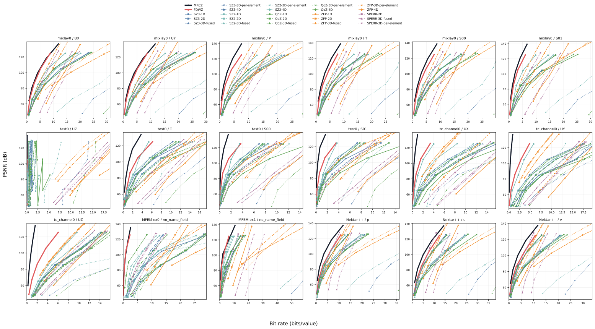
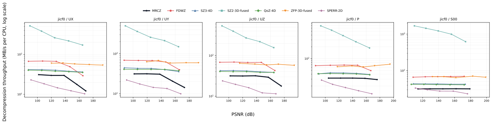
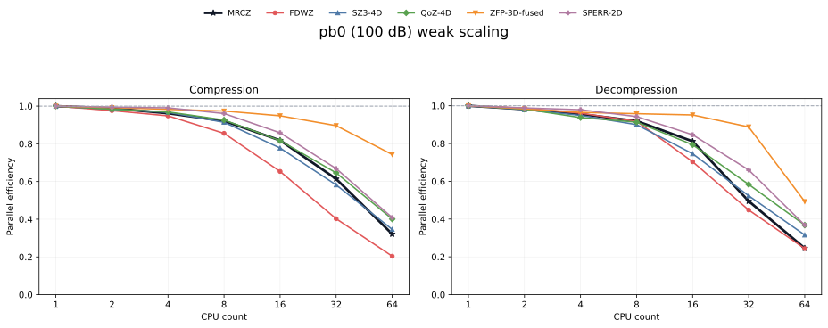
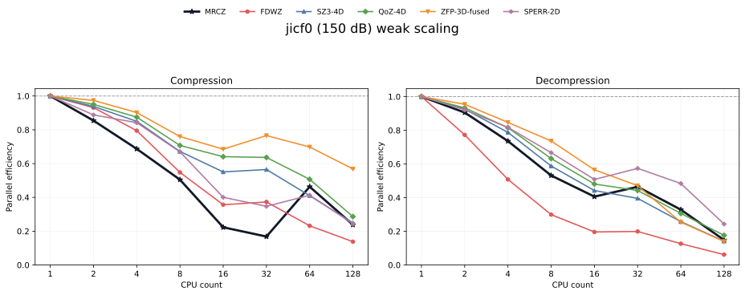
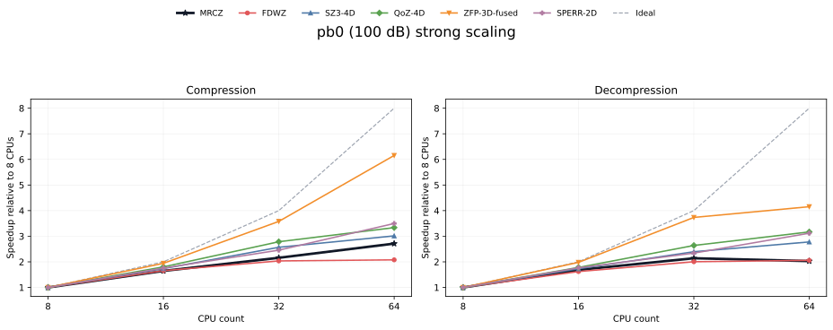
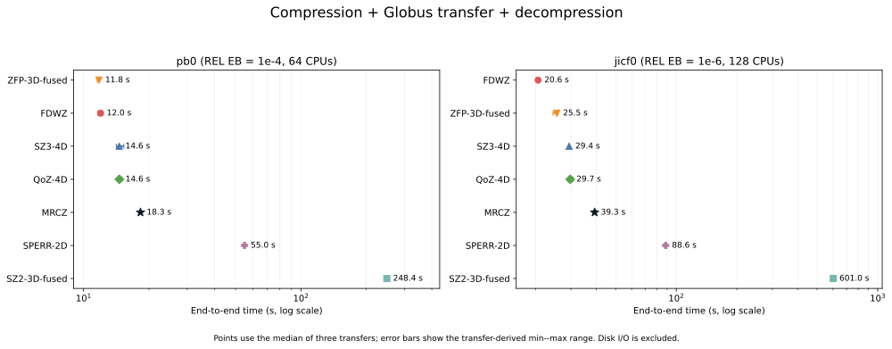

# MRCZ

## 脚本列表

<table class="fixed-layout-table" width="100%">
  <colgroup>
    <col width="30%">
    <col width="70%">
  </colgroup>
  <thead>
    <tr>
      <th width="30%">脚本</th>
      <th width="70%">功能</th>
    </tr>
  </thead>
  <tbody>
    <tr><td><code>t1_start_c_code.py</code></td><td>构建并运行C++压缩与解压程序，执行主要rate-distortion和throughput实验，并将各field的结果写入CSV。</td></tr>
    <tr><td><code>t2_find_three_irregular_elements.py</code></td><td>在NekRS数据中寻找三个两两共享面的非平面element，并生成三个element、其中一个element的分层节点及reference element的交互式三维图。</td></tr>
    <tr><td><code>t3_test_interpolation_prediction.py</code></td><td>随机抽取NekRS element、寻找共享面邻居，比较跨公共面预测与element内部预测两种一阶方案，并生成相对绝对误差ECDF。</td></tr>
    <tr><td><code>t3_test_cubic_face_prediction.py</code></td><td>在共享面的中央目标点上比较跨element与沿共享面的cubic预测，分别使用有符号物理距离和reference-space GLL坐标计算权重，并输出NRMSE和NMAE。</td></tr>
    <tr><td><code>t4_plot_data_coeff_err_distribution.py</code></td><td>比较NekRS文件中第一个标量field、对应变换系数和误差的概率分布，输出三联直方图；运行前需要准备逐点对应的float64 <code>_coeff</code>和<code>_err</code>二进制文件。</td></tr>
    <tr><td><code>t5_start_weak_scaling.py（旧）</code></td><td>对每个method/field使用由完整数据RD曲线的目标PSNR确定的REL EB，并在各CPU数和数据区间固定对应的ABS EB与计算精度，执行单节点weak scaling实验；可选择端点、等宽区间中点或完整partition覆盖，结果写入<code>results/weak_scaling/</code>中的raw、summary和quality CSV。</td></tr>
    <tr><td><code>t6_start_strong_scaling.py（旧）</code></td><td>复用<code>t5_start_weak_scaling.py</code>中每个method/field的目标PSNR配置，固定完整数据范围、ABS EB、计算精度和partition网格，只改变OpenMP线程数执行单节点strong scaling实验。</td></tr>
    <tr><td><code>generate_mfem_and_nektar_data.py</code></td><td>构建MFEM ex0/ex1，下载Nektar++ cylinder教程数据并构建FieldConvert，生成项目使用的两个MFEM样例和cylinder VTU数据。</td></tr>
  </tbody>
</table>

`py_funcs/`中的辅助功能：

<table class="fixed-layout-table" width="100%">
  <colgroup>
    <col width="30%">
    <col width="70%">
  </colgroup>
  <thead>
    <tr>
      <th width="30%">文件</th>
      <th width="70%">功能</th>
    </tr>
  </thead>
  <tbody>
    <tr><td><code>read_nekrs_header.py</code></td><td>解析NekRS field文件头，返回字节序、数据精度、element shape、element数量和field信息。</td></tr>
    <tr><td><code>interpolate_br_at_psnr.py</code></td><td>整理BR--PSNR曲线，并线性插值得到指定PSNR下的BR。</td></tr>
    <tr><td><code>plot_small_rd.py</code></td><td>根据18个小数据field的正式CSV生成RD汇总图。</td></tr>
    <tr><td><code>summarize_rd.py</code></td><td>对每个field在七种正式方法共同PSNR区间的近中点处汇总CR增长，并生成逐field CSV。</td></tr>
    <tr><td><code>plot_large_rd.py</code></td><td>为pb0或jicf0单独生成五个field的正式RD图。</td></tr>
    <tr><td><code>plot_large_throughput.py</code></td><td>根据pb0和jicf0的正式CSV生成以REL EB或PSNR为横坐标的压缩与解压throughput图。</td></tr>
    <tr><td><code>summarize_end_to_end.py</code></td><td>合并固定REL EB的RD内部计时与三次Globus传输结果，生成端到端时间汇总CSV。</td></tr>
    <tr><td><code>plot_end_to_end.py</code></td><td>根据端到端汇总结果生成总时间及三次传输波动范围图。</td></tr>
    <tr><td><code>create_transfer_csv.py</code></td><td>核对七种方法各五个压缩文件的存在性与总字节数，并初始化三次Globus传输记录。</td></tr>
    <tr><td><code>plot_weak_scaling_dataset.py</code></td><td>为pb0或jicf0单独生成weak scaling efficiency图。</td></tr>
    <tr><td><code>plot_strong_scaling_dataset.py</code></td><td>根据固定完整数据范围的strong scaling汇总结果生成压缩与解压speedup图。</td></tr>
    <tr><td><code>merge_jicf_fdwz_weak.py</code></td><td>校验并合并jicf0 FDWZ的全覆盖补测结果，按重叠case校正节点速度差异，再更新正式raw、summary和quality CSV。</td></tr>
    <tr><td><code>merge_method_csv.py</code></td><td>按REL EB及可选的CPU和partition配置，将指定方法的结果列从一组CSV合并到另一组对应CSV；可从指定Git版本读取目标CSV作为合并基线。</td></tr>
    <tr><td><code>merge_pb0_strong_64.py</code></td><td>校验pb0的8--32 CPU strong scaling结果并复用同配置的64 CPU weak scaling结果，记录每个数据点的来源任务与节点。</td></tr>
  </tbody>
</table>

## 安装

需要Python 3、CMake、支持C++20和OpenMP的C++编译器。绘图与分析脚本还需要NumPy、SciPy、Matplotlib和Plotly。

克隆项目并初始化submodule：

```bash
git clone --recurse-submodules git@github.com:ZizheJian/mrcz.git
cd mrcz
```

如果项目已经克隆：

```bash
git submodule update --init --recursive
```

创建Python环境：

```bash
python3 -m venv mrcz_env
source mrcz_env/bin/activate
python -m pip install --upgrade pip
python -m pip install numpy scipy matplotlib plotly
```

推荐直接运行`t1_start_c_code.py`。它会依次构建并安装SPERR、MFEM和MRCZ，然后执行当前配置的实验：

```bash
python3 t1_start_c_code.py
```

安装后的可执行文件位于`install/bin/mrcz_compress`和`install/bin/mrcz_decompress`。

如果只想安装而不运行实验，或者需要单独控制CMake配置，也可以手动构建：

```bash
cmake -S third_party/sperr -B build/sperr_build -DCMAKE_INSTALL_PREFIX="$PWD/install/sperr_install" -DBUILD_SHARED_LIBS=OFF
cmake --build build/sperr_build --parallel 8
cmake --install build/sperr_build

cmake -S third_party/mfem -B build/mfem_build -DCMAKE_INSTALL_PREFIX="$PWD/install/mfem_install"
cmake --build build/mfem_build --parallel 8
cmake --install build/mfem_build

cmake -S c_codes -B build -DCMAKE_INSTALL_PREFIX="$PWD/install"
cmake --build build --parallel 8
cmake --install build
```

安装后，外部C++项目可以通过CMake导入header-only MRCZ核心：

```cmake
find_package(MRCZ CONFIG REQUIRED)
target_link_libraries(my_program PRIVATE mrcz::mrcz)
```

程序包含公共header：

```cpp
#include <mrcz_core/mrcz.hpp>
```

如果MRCZ未安装到系统默认路径，配置外部项目时通过`CMAKE_PREFIX_PATH`指定MRCZ安装目录；MRCZ会自动传递C++20、OpenMP、Zstd、tinyxml2和MFEM依赖。

submodule中提供了三个可直接测试的NekRS小数据：

- `third_party/pySEMTools/examples/data/mixlay0.f00001`
- `third_party/pySEMTools/examples/data/tc_channel0.f00001`
- `third_party/fld_pyutils/demos/data/test0.f00001`

MFEM和Nektar++验证数据可通过以下命令重新生成：

```bash
python3 generate_mfem_and_nektar_data.py
```

脚本生成`build/mfem_build/examples/ex0examples/`、`build/mfem_build/examples/ex1examples/`和`third_party/flow-stability-cylinder/tutorial/base/Cylinder-Base.vtu`。

# 1. 简介

本项目研究高阶有限元与谱元模拟数据的误差有界有损压缩，主要面向NekRS/Nek5000等程序生成的三维物理场，并使用MFEM和Nektar++样例验证数据布局的通用性。此类数据由大量高阶element组成：element之间按非规则网格及拓扑关系组织，而每个element内部的采样点通常位于Gauss--Lobatto--Legendre（GLL）节点上，形成尺寸较小但结构固定的张量积网格。物理场在单个element内部通常较平滑，但跨element的存储顺序、尺度和局部变化可能不连续，因此把数据简单展平或视为普通规则网格会损失可利用的结构。

项目的核心目标是在严格满足逐点误差界限的前提下，改善压缩率、压缩与解压吞吐量。主要方法MRCZ对每个element进行GLL张量基变换，分别编码变换系数与点值残差，再通过coefficient-major布局、Huffman和Zstd压缩；候选方法FDWZ则直接利用GLL节点距离进行自适应插值预测。两者与通用压缩器的官方API进行比较：先在小数据集上评估各API最理想的数据布局，再将为每种baseline选定的布局用于正式大数据实验。

所有方法共用field级外围流程，包括读取数据、计算值域与ABS/REL error bound、选择计算精度以及写入公共bitstream信息。若一个field的最大值和最小值可以由其中点在`abs_eb`内同时重建，公共层会只保存constant flag和该中点，并跳过具体backend；因此constant compression不是任何单个算法的组成部分，可通过`param.if_constant_compression`控制。

项目主入口为`t1_start_c_code.py`，其中定义正式数据集、field、误差界限、方法列表以及结果文件位置。正式CSV保存在对应数据旁边，方法与baseline布局见第5章；本文档后半部分记录投稿之前仍需完成的工作。

两个新压缩器都有一个正式版和一个消融实验版，另外正式版可以选择性地开启分段计时。

# 2. FDWZ核心与优化记录

FDWZ（Fast Distance-Weighted Interpolation-Based Lossy Compressor）借鉴SZ3的多层插值预测框架，但预测范围限制在单个高阶element内，并使用reference-space GLL节点坐标而不是均匀索引距离。它不是对官方SZ3的简单参数调整，而是项目内为高阶有限元/谱元数据实现的独立预测器。

## 2.1. 核心流程

1. 根据element shape和各维reference-space GLL坐标预先构造可由编解码两端确定性复现的预测层、访问顺序、reference位置及插值权重。每个有效维度的两个端点构成初始边界，递归选择reference space中最接近两端点中点的未编码GLL节点。
2. 每个二维/三维element的4/8个角点直接进行误差有界量化；其余节点按照预测层和维度顺序逐步处理。linear模式使用两个已重建reference按reference-space GLL间距进行一次插值；cubic模式则根据当前可用的已重建reference数量，自适应使用三次、二次或一次Lagrange插值。
3. 每次预测后立即量化prediction residual，并用量化结果覆盖目标值。后续预测只引用该重建值，因此压缩端与解压端具有完全相同的误差传播路径，并保证逐点误差界限。
4. FDWZ在每个partition内进行确定性的均匀采样，默认采样间隔为128且至少取32个样本。sample真实压缩六种linear维度顺序，再以最佳linear的方向执行正式cubic压缩。
5. 量化整数按照角点及预测层分组。正式FDWZ固定使用当前element shape允许的最大Huffman tree数，最多五棵；每个partition独立建立Huffman tree，将全部Huffman metadata和payload拼接后再压缩为一个Zstd frame。QB固定使用32位存储，并保留`INT32_MIN`作为unpredictable标记。为避免对每个预测点都执行溢出检查，程序先根据field的最小值、最大值、ABS EB和全部cubic stencil权重证明residual QB可安全存入`int32_t`。无法在field级证明时才逐点检查；超出范围的点使用`INT32_MIN`标记，并在全部Huffman流后按出现顺序追加其原始浮点值。角点的预测值为零，因此始终逐点检查其QB范围。
6. partition之间彼此独立，通过OpenMP并行执行采样、预测、量化、Huffman和Zstd；解压端按相反顺序恢复Huffman符号，并在每个element内依次重建节点。

## 2.2. 角点

<table class="fixed-layout-table" width="100%">
  <colgroup><col width="30%"><col width="10%"><col width="60%"></colgroup>
  <thead><tr><th width="30%">优化方案</th><th width="10%">状态</th><th width="60%">已有结论</th></tr></thead>
  <tbody>
    <tr>
      <td>角点预测为0并直接量化</td>
      <td>采纳</td>
      <td>最简单且在五个NekRS数据上最稳定。</td>
    </tr>
    <tr>
      <td>使用前一编号element预测角点</td>
      <td>放弃</td>
      <td>依赖编号相邻element具有物理相关性，完整bitstream没有稳定收益。</td>
    </tr>
    <tr>
      <td>element内角点Lorenzo、角点均值加deviation及其组合</td>
      <td>放弃</td>
      <td>局部角点流偶有改善，但额外符号或后续误差传播抵消了完整BR收益。</td>
    </tr>
    <tr>
      <td>先建立中心、最后向外外插角点</td>
      <td>放弃</td>
      <td>角点/中心点预测误差诊断已排除该方向。</td>
    </tr>
  </tbody>
</table>

## 2.3. 预测结构、范围与访问顺序

<table class="fixed-layout-table" width="100%">
  <colgroup><col width="30%"><col width="10%"><col width="60%"></colgroup>
  <thead><tr><th width="30%">优化方案</th><th width="10%">状态</th><th width="60%">已有结论</th></tr></thead>
  <tbody>
    <tr>
      <td>按reference-space GLL中点递归并使用reference-space GLL间距计算权重</td>
      <td>采纳</td>
      <td>比索引中点更符合非均匀GLL节点分布，是正式预测树的基础。</td>
    </tr>
    <tr>
      <td>三维数据中的六种维度顺序</td>
      <td>采纳</td>
      <td>不存在跨数据和partition普遍最优的固定顺序。官方SZ3调优只比较正序与逆序，但FDWZ限制为<code>XYZ/ZYX</code>后，即使使用完整数据oracle选择，小数据65个field/EB case的平均BR regret约2.97%、最大约21.80%，因此没有照搬。</td>
    </tr>
    <tr>
      <td>cubic插值</td>
      <td>采纳</td>
      <td>正式预测固定使用cubic，大部分情况下都比同方向的linear好。采样阶段比较六种linear顺序并将最佳方向映射到对应cubic。</td>
    </tr>
    <tr>
      <td>surface-first：按边、面、体及中心向外顺序预测</td>
      <td>放弃</td>
      <td>在代表性数据上没有形成rate--distortion优势。</td>
    </tr>
    <tr>
      <td>normal-boundary：先建立中心块，再沿法向外插边界</td>
      <td>放弃</td>
      <td>五个数据上均被正式reference-space中点预测树Pareto支配。</td>
    </tr>
    <tr>
      <td>官方SZ3式2幂stride、单原点seed的index-order</td>
      <td>放弃</td>
      <td>对小element反复支付粗层级远距离预测成本，三个小数据均无优势。</td>
    </tr>
    <tr>
      <td>不预测reference-space中点，而是预测索引中点</td>
      <td>放弃</td>
      <td>pb0和jicf0的BR分别增加约8.4%和4.7%，说明reference-space距离比索引邻近更重要。</td>
    </tr>
    <tr>
      <td>element编号方向预测</td>
      <td>放弃</td>
      <td>在五个数据上严格优于所有element内方向的点不足约1.1%，加入空间oracle后的总体改善很小。</td>
    </tr>
    <tr>
      <td>相邻element的公共面上的预测</td>
      <td>放弃</td>
      <td>当前实现的跨公共面预测没有优于element内预测，同时会引入邻居搜索和拓扑metadata成本。</td>
    </tr>
    <tr>
      <td>QoZ式GLL预测路径</td>
      <td>放弃</td>
      <td>test0/UZ上的BR明显差于FDWZ。</td>
    </tr>
  </tbody>
</table>

## 2.4. 量化与residual建模阶段

<table class="fixed-layout-table" width="100%">
  <colgroup><col width="30%"><col width="10%"><col width="60%"></colgroup>
  <thead><tr><th width="30%">优化方案</th><th width="10%">状态</th><th width="60%">已有结论</th></tr></thead>
  <tbody>
    <tr>
      <td>对之后仍会被引用的reference使用更严格EB</td>
      <td>放弃</td>
      <td>同PSNR下仅mixlay0约有2%收益，其余数据持平或退化，不足以承担选择复杂度。</td>
    </tr>
    <tr>
      <td>每个局部位置学习prediction-residual bias</td>
      <td>放弃</td>
      <td>单bin峰值和带置信度的稳健宽窗口版本都不能覆盖采样与bias metadata开销，且降低吞吐量。</td>
    </tr>
    <tr>
      <td>根据前面element在线更新预测统计</td>
      <td>放弃</td>
      <td>会引入顺序依赖和同步成本，没有进入正式bitstream。</td>
    </tr>
  </tbody>
</table>

## 2.5. QB布局、Huffman与Zstd阶段

<table class="fixed-layout-table" width="100%">
  <colgroup><col width="30%"><col width="10%"><col width="60%"></colgroup>
  <thead><tr><th width="30%">优化方案</th><th width="10%">状态</th><th width="60%">已有结论</th></tr></thead>
  <tbody>
    <tr>
      <td>非角点QB按实际预测访问顺序保存</td>
      <td>采纳</td>
      <td>大数据随机段上稳定降低约5%--7% BR，压缩吞吐代价约1%，解压局部性也更好。</td>
    </tr>
    <tr>
      <td>非角点QB转置，使element编号维度最快</td>
      <td>放弃</td>
      <td>pb0和jicf0平均BR分别增加约4.2%和3.5%，跨步访问还显著破坏缓存局部性。</td>
    </tr>
    <tr>
      <td>将角点流从element-contiguous转成local-symbol-contiguous</td>
      <td>放弃</td>
      <td>test0、mixlay0和jicf0退化，仅tc_channel0和pb0小幅改善。</td>
    </tr>
    <tr>
      <td>1--5棵Huffman tree分离角点和不同预测层</td>
      <td>采纳</td>
      <td>大partition上多tree可利用各预测层不同的符号分布；正式FDWZ按element shape固定使用最大有效tree数，最多五棵，避免额外tree选择逻辑。</td>
    </tr>
    <tr>
      <td>32位QB与unpredictable原值逃逸</td>
      <td>采纳</td>
      <td><code>INT32_MIN</code>作为标记，超出32位范围或浮点重构不安全的点在Huffman流后顺序保存无损原值，不再整块回退64位；能够通过field级上界和精度检查的预测点使用快速量化路径。pb0/P、64核同节点测试中，32位QB在<code>1e-4</code>和<code>1e-5</code>下比64位实现分别快约11.0%和14.8%；18个小数据field的90个常规case全部通过误差界。</td>
    </tr>
    <tr>
      <td>从sample直接选择huffman tree数量</td>
      <td>放弃</td>
      <td>小sample无法正确摊销tree metadata，tree数与完整partition的最优选择经常不一致。</td>
    </tr>
    <tr>
      <td>根据sample估算不同Huffman tree数量的完整压缩成本</td>
      <td>放弃</td>
      <td>regret仍不够稳定；最终固定最大有效tree比自适应规则更简单稳健。</td>
    </tr>
    <tr>
      <td>每个partition的多个Huffman流合并到一个Zstd frame</td>
      <td>采纳</td>
      <td>保留不同符号分布的Huffman收益，同时让Zstd继续利用整个partition的字节级冗余。</td>
    </tr>
  </tbody>
</table>

## 2.6. 配置采样、并行与实现加速阶段

<table class="fixed-layout-table" width="100%">
  <colgroup><col width="30%"><col width="10%"><col width="60%"></colgroup>
  <thead><tr><th width="30%">优化方案</th><th width="10%">状态</th><th width="60%">已有结论</th></tr></thead>
  <tbody>
    <tr>
      <td>partition内确定性的均匀采样</td>
      <td>采纳</td>
      <td>正式配置使用<code>interval=128</code>和<code>min=32</code>。相对完整比较六种固定cubic的oracle，18个小数据field在各自共同PSNR近中点处平均CR regret约0.34%、最大4.34%，均低于5%。</td>
    </tr>
    <tr>
      <td>只采样partition连续前缀</td>
      <td>放弃</td>
      <td>对非平稳partition代表性不足，曾出现超过100%的holdout regret。</td>
    </tr>
    <tr>
      <td>预计算prediction stencil和GLL权重</td>
      <td>采纳</td>
      <td>避免在每个element重复构造预测关系，并保证编解码路径一致。</td>
    </tr>
    <tr>
      <td>partition级OpenMP并行</td>
      <td>采纳</td>
      <td>partition天然独立，无需在element预测树内部增加同步。</td>
    </tr>
    <tr>
      <td>四个element分批执行正式预测</td>
      <td>采纳</td>
      <td>保持每个element内部预测顺序不变，同时复用stencil读取并增加独立指令；两个本地数据上的端到端压缩时间减少约2%--5%，bitstream逐字节不变。八个element一批没有进一步收益。</td>
    </tr>
    <tr>
      <td>未初始化的Huffman/Zstd输出工作区</td>
      <td>采纳</td>
      <td>避免<code>vector(size)</code>对最坏情况缓冲做无意义清零，仍将实际allocation计入codec wall time；两个本地数据上的端到端压缩时间减少约9%--14%，bitstream逐字节不变。</td>
    </tr>
    <tr>
      <td>跨element AVX2并行预测与量化</td>
      <td>放弃</td>
      <td>约256 KB tile解决了整partition position-major访问的缓存退化，但float没有收益，double端到端仅约快9%，不足以承担独立舍入语义和复杂实现，因此未正式合并。</td>
    </tr>
  </tbody>
</table>

# 3. MRCZ核心与优化记录

MRCZ是一种面向高阶有限元/谱元数据的model-representation-based compressor。它将每个element转换为一组描述局部场的基系数，以量化后的低误差模型重建值作为全部节点的预测，再单独编码逐点residual。这个两级表示同时利用了element内的高阶光滑性，并通过residual量化提供与具体变换无关的严格逐点误差界限。

## 3.1. 核心流程

1. 根据element shape和各维真实GLL节点，为每个有效维度构造DChT（Discrete Chebyshev Transform）的一维基函数求值矩阵及其逆矩阵。三维正变换和反变换均按三个维度依次执行张量积矩阵运算。
2. 对每个element执行正变换，将nodal values转换为transform coefficients。所有系数使用`coeff_eb=0.05*abs_eb`统一量化，并立即用量化后的系数值覆盖原系数。
3. 对量化系数执行反变换，得到该element所有节点的近似值。随后计算原始值与该近似值之间的pointwise residual，并使用用户指定的`abs_eb`量化。解压端以相同量化系数完成反变换并叠加重建residual，因此最终逐点误差不超过`abs_eb`；变换本身不需要正交，只需要可逆且数值稳定。
4. 每个partition内的coefficient QB由element-major转为coefficient-major，使相同基模式的系数在不同element间连续排列；residual QB保持element-major。coefficient QB和residual QB分别建立一棵Huffman tree，Huffman metadata和payload拼接后共同压缩为一个Zstd frame。
5. partition之间独立并通过OpenMP并行。每个线程复用一组partition-local coefficient/residual缓冲区。

## 3.2. 变换与系数的量化

<table class="fixed-layout-table" width="100%">
  <colgroup><col width="30%"><col width="10%"><col width="60%"></colgroup>
  <thead><tr><th width="30%">优化方案</th><th width="10%">状态</th><th width="60%">已有结论</th></tr></thead>
  <tbody>
    <tr>
      <td>在真实GLL节点上使用DChT</td>
      <td>采纳</td>
      <td>旧稿实验中，同PSNR下DChT+GLL相对DLT+GLL约改善20% CR；主要收益来自更集中的系数分布，而不是residual差异。</td>
    </tr>
    <tr>
      <td>DLT、DST、DCT以及将节点视为uniform的变换</td>
      <td>放弃</td>
      <td>已比较不同基函数和节点假设，整体rate--distortion不如DChT+GLL稳定；实现仍允许构造部分变换，但正式MRCZ固定使用DChT+GLL。</td>
    </tr>
    <tr>
      <td>全局<code>coeff_eb_scale=0.05</code></td>
      <td>采纳</td>
      <td>在系数码率与反变换预测精度之间形成稳定折中；过小会浪费用户误差预算，过大会增加BR。</td>
    </tr>
    <tr>
      <td>按模式的L1/RMS敏感度、乘积或总阶数分配coefficient EB</td>
      <td>放弃</td>
      <td>不同数据上的BR变化方向不一致，系数流与residual流经常相互抵消，未形成稳定规则。</td>
    </tr>
    <tr>
      <td>扩大量化为零的低频系数区间</td>
      <td>放弃</td>
      <td>mixlay0和jicf0上的同PSNR结果均更差，不能仅依靠增加零系数改善完整bitstream。</td>
    </tr>
  </tbody>
</table>

## 3.3. QB布局、Huffman与Zstd阶段

<table class="fixed-layout-table" width="100%">
  <colgroup><col width="30%"><col width="10%"><col width="60%"></colgroup>
  <thead><tr><th width="30%">优化方案</th><th width="10%">状态</th><th width="60%">已有结论</th></tr></thead>
  <tbody>
    <tr>
      <td>coefficient-major布局</td>
      <td>采纳</td>
      <td>相同基模式跨element连续排列，可聚集高阶模式中的大量零值及同模式统计规律；旧稿实验中约改善20% CR。</td>
    </tr>
    <tr>
      <td>partition级coefficient zero map，用于标注某个model的系数是否在partition内所有element上全部被量化为0</td>
      <td>放弃</td>
      <td>jicf0五个field、五个EB上的CR平均仅提高约0.107%、最大约0.486%，不足以补偿扫描、metadata和格式复杂度。</td>
    </tr>
    <tr>
      <td>coefficient与residual各使用一棵Huffman tree</td>
      <td>采纳</td>
      <td>两类QB分布不同，独立建树后仍可放入同一Zstd frame利用partition级字节冗余。</td>
    </tr>
    <tr>
      <td>按系数总阶数拆成2--4棵Huffman tree</td>
      <td>放弃</td>
      <td>小数据上最多有约10%的平均BR收益，但jicf0大partition上三树和四树相对单树仅改善约1.1%且依赖数据区域，正式格式保持单棵coefficient tree。</td>
    </tr>
    <tr>
      <td>coefficient和residual的Huffman流合并到一个Zstd frame</td>
      <td>采纳</td>
      <td>避免为同一partition支付多个Zstd frame，并允许Zstd继续利用两段Huffman数据的字节级冗余。</td>
    </tr>
  </tbody>
</table>

## 3.4. 并行、内存与实现加速阶段

<table class="fixed-layout-table" width="100%">
  <colgroup><col width="30%"><col width="10%"><col width="60%"></colgroup>
  <thead><tr><th width="30%">优化方案</th><th width="10%">状态</th><th width="60%">已有结论</th></tr></thead>
  <tbody>
    <tr>
      <td>支持任意<code>(n0,n1,n2)</code>的统一变换内核</td>
      <td>采纳</td>
      <td>等尺寸专用内核在8x8x8 element上的性能差异不足1%，删除重复的regular/irregular路径更易维护。</td>
    </tr>
    <tr>
      <td>连续指针访问并由编译器自动生成AVX2</td>
      <td>采纳</td>
      <td>重构六个张量变换内层循环后，GCC能够使用32-byte vector；pb0/T计算节点样例的压缩和解压分别加速约1.36x和1.38x，bitstream与误差结果不变。</td>
    </tr>
    <tr>
      <td>32x32分块coefficient transpose</td>
      <td>采纳</td>
      <td>以cache-aware tiled transpose完成element-major到coefficient-major的布局转换，不改变bitstream；pb0/T样例中压缩和解压时间分别减少约11.3%和14.7%。</td>
    </tr>
    <tr>
      <td>只添加<code>#pragma omp simd</code>或手写transform intrinsics</td>
      <td>放弃</td>
      <td>单独添加pragma曾使压缩变慢约1.5%--3%；指针重构已能触发稳定自动向量化，无需维护手写intrinsics。</td>
    </tr>
    <tr>
      <td>跨element batched transform</td>
      <td>放弃</td>
      <td>float/double批处理能够逐字节复现正式bitstream，但独立消融中transform本身反而变慢；组合收益主要来自绕过素朴转置，已由32x32分块转置以更简单方式获得，因此未正式合并。</td>
    </tr>
    <tr>
      <td>partition级OpenMP与独立<code>partition_num</code></td>
      <td>采纳</td>
      <td>partition边界决定bitstream，<code>max_cpus</code>只决定并发度；固定partition时不同线程数可产生相同结果，并避免实现partition内并行Huffman。</td>
    </tr>
    <tr>
      <td>每线程复用partition-local QB缓冲区</td>
      <td>采纳</td>
      <td>避免同时为整个field保留两份完整<code>int64_t</code>数组；pb0/T样例的峰值RSS由约595 MB降至245 MB，同时略微缩短压缩时间。</td>
    </tr>
  </tbody>
</table>

# 4. 消融实验

- 调优coefficient transpose的tile size：比较`8x8`、`16x16`、`32x32`、`64x64`和`128x128`，分别记录压缩与解压transpose阶段时间；当前`32x32`只验证过优于未分块transpose，尚未证明是最优值。同步检查各版本是否由编译器生成SIMD/AVX2指令，区分cache blocking与自动向量化的收益。
- 测试SZ2的`SZ_compress_customize_threadsafe`：在进入OpenMP并行区前完成一次`SZ_Init()`，为各partition使用相同数据类型和ABS EB并恢复partition级并行，解压端暂时保持串行。使用不同局部值域的partition反复检查bitstream可解码性、逐点误差界限和结果稳定性，通过后再用于正式throughput实验。

# 5. Rate-distortion结果

以下CR增长均由RD曲线在相同PSNR下插值得到，不比较相同REL EB的点。对每个field先求MRCZ、FDWZ和五个正式官方baseline共同覆盖的PSNR区间，再选择最接近区间中点的整数PSNR；不同field使用各自的目标PSNR。

五个baseline为SZ3-4D、SZ2-3D-fused、QoZ-4D、ZFP-3D-fused和SPERR-2D；每个field在目标PSNR处取其中最低BR。大数据汇总10个field；小数据不计入RD曲线接近PSNR轴的test0/UZ，汇总其余17个field。各field等权，逐field共同区间、目标PSNR和最优baseline保存在`results/RD/midpoint_cr_summary.csv`，统计可由`python3 py_funcs/summarize_rd.py`复现。

<table class="fixed-layout-table" width="100%">
  <colgroup><col width="18%"><col width="34%"><col width="14%"><col width="14%"><col width="20%"></colgroup>
  <thead><tr><th width="18%">数据</th><th width="34%">比较</th><th width="14%">CR平均增长</th><th width="14%">CR最大增长</th><th width="20%">最大值对应field</th></tr></thead>
  <tbody>
    <tr><td>pb0</td><td>MRCZ相对FDWZ</td><td>125.30%</td><td>130.00%</td><td>P</td></tr>
    <tr><td>pb0</td><td>FDWZ相对最优官方baseline</td><td>37.84%</td><td>49.05%</td><td>UX</td></tr>
    <tr><td>jicf0</td><td>MRCZ相对FDWZ</td><td>97.49%</td><td>131.83%</td><td>P</td></tr>
    <tr><td>jicf0</td><td>FDWZ相对最优官方baseline</td><td>123.72%</td><td>205.87%</td><td>P</td></tr>
    <tr><td>大数据</td><td>MRCZ相对FDWZ</td><td>111.39%</td><td>131.83%</td><td>jicf0/P</td></tr>
    <tr><td>大数据</td><td>FDWZ相对最优官方baseline</td><td>80.78%</td><td>205.87%</td><td>jicf0/P</td></tr>
    <tr><td>小数据</td><td>MRCZ相对FDWZ</td><td>136.66%</td><td>669.47%</td><td>tc_channel0/UY</td></tr>
    <tr><td>小数据</td><td>FDWZ相对最优官方baseline</td><td>58.83%</td><td>359.95%</td><td>MFEM ex0/no_name_field</td></tr>
  </tbody>
</table>

## 5.1. 小数据布局选择

小数据实验使用mixlay0、test0、tc_channel0三个NekRS数据集、MFEM ex0/ex1两个样例和Nektar++ cylinder样例。各数据的非常数field如下：

<table class="fixed-layout-table" width="100%">
  <colgroup><col width="25%"><col width="75%"></colgroup>
  <thead><tr><th width="25%">数据</th><th width="75%">非常数field</th></tr></thead>
  <tbody>
    <tr><td>mixlay0</td><td>UX、UY、P、T、S00、S01</td></tr>
    <tr><td>test0</td><td>UZ、T、S00、S01</td></tr>
    <tr><td>tc_channel0</td><td>UX、UY、UZ</td></tr>
    <tr><td>MFEM ex0</td><td>no_name_field</td></tr>
    <tr><td>MFEM ex1</td><td>no_name_field</td></tr>
    <tr><td>Nektar++ cylinder</td><td>p、u、v</td></tr>
  </tbody>
</table>

实验比较MRCZ、FDWZ以及官方SZ3、SZ2、QoZ、ZFP和SPERR API。每个case使用完整field、1 CPU和1个partition，REL EB为`1e-2`、`1e-3`、`1e-4`、`1e-5`和`1e-6`；正式结果重测同样固定使用1 CPU。各官方API可用的布局如下：

<table class="fixed-layout-table" width="100%">
  <colgroup><col width="20%"><col width="16%"><col width="16%"><col width="16%"><col width="16%"><col width="16%"></colgroup>
  <thead><tr><th width="20%">官方API</th><th width="16%">1D</th><th width="16%">2D</th><th width="16%">fused 3D</th><th width="16%">per-element 3D</th><th width="16%">4D</th></tr></thead>
  <tbody>
    <tr><td>SZ3</td><td>✓</td><td>✓</td><td>✓</td><td>✓</td><td>✓</td></tr>
    <tr><td>SZ2</td><td>✓</td><td>✓</td><td>✓</td><td>✓</td><td>✓</td></tr>
    <tr><td>QoZ</td><td>✓</td><td>✓</td><td>✓</td><td>✓</td><td>✓</td></tr>
    <tr><td>ZFP</td><td>✓</td><td>✓</td><td>✓</td><td>✓</td><td>✓</td></tr>
    <tr><td>SPERR</td><td>—</td><td>✓</td><td>✓</td><td>✓</td><td>—</td></tr>
  </tbody>
</table>

设一个partition包含`E`个element，每个element的shape为`[N0,N1,N2]`，`N=N0*N1*N2`。各布局调用官方API的方式如下：

<table class="fixed-layout-table" width="100%">
  <colgroup><col width="25%"><col width="75%"></colgroup>
  <thead><tr><th width="25%">布局</th><th width="75%">API调用</th></tr></thead>
  <tbody>
    <tr><td>1D</td><td>将整个partition作为<code>[E*N]</code>调用一次</td></tr>
    <tr><td>2D</td><td>作为<code>[E,N]</code>调用一次</td></tr>
    <tr><td>fused 3D</td><td>作为<code>[E*N0,N1,N2]</code>调用一次</td></tr>
    <tr><td>per-element 3D</td><td>对每个<code>[N0,N1,N2]</code> element分别调用，并保存各bitstream长度</td></tr>
    <tr><td>4D</td><td>作为<code>[E,N0,N1,N2]</code>调用一次</td></tr>
  </tbody>
</table>

官方库中需要保留的特殊处理如下；SPERR缺少1D和4D入口已由上表体现。

<table class="fixed-layout-table" width="100%">
  <colgroup><col width="25%"><col width="75%"></colgroup>
  <thead><tr><th width="25%">官方API</th><th width="75%">特殊处理</th></tr></thead>
  <tbody>
    <tr><td>SZ3</td><td>float路径传入<code>0.999*abs_eb</code>，避免曾观测到的约0.031%误差越界</td></tr>
    <tr><td>SZ2</td><td>会删除长度为1的维度；完整3D element的4D与fused 3D路径产生相同bitstream。其状态为进程级全局变量，不能安全并发，因此正式封装串行调用且不报告多CPU scaling</td></tr>
    <tr><td>SZ2（MFEM ex1）</td><td><code>5x5x1</code> per-element布局在REL <code>1e-4</code>会触发官方库allocator断言；失败保留在原始结果中</td></tr>
    <tr><td>QoZ</td><td>删除长度为1的维度；q4自动调优只用于2D/3D，1D通过官方API固定使用插值后端，以避开默认路径的heap corruption</td></tr>
  </tbody>
</table>

完整布局矩阵包含25种方法、18个非常数field和5个REL EB，共2250个case；其中2249个成功并满足error bound，唯一失败是上表所列MFEM ex1的per-element SZ2案例。

在各布局共同覆盖的PSNR范围内插值BR并比较regret后，正式大数据baseline固定为SZ3-4D、SZ2-3D-fused、QoZ-4D、ZFP-3D-fused和SPERR-2D。per-element 3D通常因大量独立bitstream、长度metadata及无法利用跨element冗余而明显退化；test0/UZ的RD曲线接近PSNR轴且无法有效区分布局，因此保留原始结果但不用于选择。这些布局在pb0和jicf0实验前即已冻结，不使用大数据结果反向挑选baseline。

## 5.2. 小数据正式方法结果

下图展示全部18个非常数field上25种方法的BR--PSNR曲线；同一种官方压缩器的不同API布局使用相同颜色和不同线型，BR横轴使用线性尺度并固定从0开始。各子图聚焦主要曲线的有效比较范围，允许高BR方法和明显偏高的PSNR端点在坐标边界处截断。FDWZ曲线于2026-09-05使用当前cubic-only、linear-proxy、`fdwz_sample_interval=128`、32位QB/unpredictable和1 CPU/1 partition重跑；90个case全部满足误差界且没有触发unpredictable，其余24种方法沿用已冻结的正式结果。



## 5.3. 大数据正式结果

大数据实验使用pb0的UX、UY、UZ、P和T五个field，以及jicf0的UX、UY、UZ、P和S00五个field。正式方法为MRCZ、FDWZ、SZ3-4D、SZ2-3D-fused、QoZ-4D、ZFP-3D-fused和SPERR-2D；pb0使用64 CPU和64个partition，REL EB为`1e-2`、`1e-3`、`1e-4`、`1e-5`和`1e-6`；jicf0使用128 CPU和128个partition，REL EB为`1e-4`、`1e-5`、`1e-6`、`1e-7`和`1e-8`。

pb0的FDWZ于2026-09-05在64 CPU、64个partition的独占节点上完成当前版本重测（Slurm job `20422881`）；五个field、五个REL EB共25个case均通过项目的`100.01%`浮点数值容差检查（最大为`100.003336%`）且没有触发unpredictable。jicf0于同日在128 CPU、128个partition的独占节点上重测；主任务`20423381`在完成前四个REL EB后达到45分钟时限，续跑任务`20424117`补齐`1e-8`。jicf0的25个case同样全部通过容差检查（最大`100.000000%`）且没有触发unpredictable。按照本章开头的口径，MRCZ相对FDWZ的CR平均增长在pb0和jicf0上分别为125.30%和97.49%；FDWZ相对最优官方baseline的CR平均增长分别为37.84%和123.72%。

pb0的当前64 CPU结果如下；BR横轴使用线性尺度并从0开始，允许明显偏高的曲线端点在坐标边界处截断。MRCZ和五个官方baseline沿用冻结结果，仅FDWZ使用当前版本重跑。


jicf0的当前128 CPU结果如下；其他六种方法同样沿用已冻结结果。


# 6. Throughput

pb0和jicf0的正式throughput分别使用64 CPU和128 CPU测量。吞吐量均为原始数据量除以backend内部耗时，并按CPU数归一化为MiB/s per CPU，图中沿用简写MB/s，纵轴使用对数尺度；backend为压缩或解压API调用本身，其内部QB、Huffman和Zstd工作区allocation仍计入对应时间。SZ2因官方API使用进程级全局状态而串行处理partition，其列表示单个实际活动CPU的整次调用吞吐量，不能再乘申请的64或128 CPU。两个数据的FDWZ使用上述当前版本结果，其他六种方法沿用冻结结果。pb0的25个同REL EB点上，FDWZ压缩和解压吞吐均全部高于SZ3-4D，几何平均吞吐比分别为1.333和1.396，最小比分别为1.083和1.278。jicf0上，FDWZ压缩在25点中的18点快于SZ3-4D，几何平均吞吐比为1.059；解压在25点中的24点更快，几何平均吞吐比为1.482。因此FDWZ的解压优势在两个大数据上都很稳定，压缩端则只能说总体达到SZ3-4D速度，jicf0的严格误差界限下仍会明显落后。另在独占节点上对pb0/P的`1e-4`与`1e-5`各重复三次，FDWZ压缩分别比SZ3-4D快19.8%和20.1%，解压分别快30.7%和37.6%。

pb0结果首先以实验直接指定的REL EB为横坐标；同一横坐标位置上的所有方法具有相同的error bound和计算精度。


随后以各方法实际达到的PSNR为横坐标，从fixed-quality角度展示压缩与解压throughput。


jicf0以REL EB和实际PSNR为横坐标的对应结果如下。




# 7. Weak scaling

实验将pb0和jicf0分别均分为64和128个全局partition，每个CPU固定处理一个partition。pb0测试`1、2、4、8、16、32、64` CPU，jicf0测试`1、2、4、8、16、32、64、128` CPU。N个CPU处理连续的N个partition，因此CPU数和数据量同步增加。pb0每个partition约含30424个element和59.42 MiB原始数据，jicf0约含25315个element和96.56 MiB原始数据；目标PSNR分别为100 dB和150 dB。

CPU数量较少时，实验只处理完整field中的局部区间，而不同区间的data range可能不同。如果直接使用REL EB，程序会根据局部data range得到不同的ABS EB，使各CPU点的实际误差界和重建质量不再一致。因此，每个method/field先根据完整数据的RD曲线插值得到目标PSNR对应的REL EB，再乘以完整field的data range得到ABS EB；所有CPU数量和抽样区间均使用这个固定的ABS EB。同时，实验通过`-compute-precision`固定使用完整数据在该REL EB下选择的float或double，避免局部data range变化导致计算精度切换。局部区间的data range还可能小到触发constant compression，因此weak scaling压缩命令统一设置`-constant-compression false`，确保每个case都实际运行对应backend。汇总PSNR也使用完整field的data range和各区间的加权MSE重新计算。

冻结的官方方法、MRCZ及pb0 FDWZ在每个CPU数、每个field测试4次。先将完整数据固定划分为最大CPU数个全局partition；使用N个CPU时，一个测试段由N个相邻partition组成，再从所有可选测试段中等间隔选择4段。例如jicf0使用2 CPU时选择全局partition `[0,2)`、`[42,44)`、`[84,86)`和`[126,128)`。当N较大、完整数据只能提供2段或1段时，每段分别重复2次或4次。每次测试先汇总全部五个field的原始数据量和内部时间，再计算综合throughput与efficiency。图中不绘制误差棒，分段结果的样本标准差仍保存在summary CSV中。正式Slurm脚本使用`OMP_PLACES=cores`和`OMP_PROC_BIND=spread`将OpenMP线程固定到物理核，并使用`--exclusive --mem=235G`独占节点及235 GiB内存；pb0程序使用64个线程，jicf0使用128个线程。

图中各方法的efficiency以自身1 CPU吞吐量为基准；SZ2官方实现使用进程级全局状态，不能安全并发，因此只有1 CPU结果且不画入趋势图。pb0的FDWZ于2026-09-05在节点a173上使用当前版本重跑（Slurm job `20424829`），140个raw case均通过`100.01%`误差容差，各field/CPU汇总PSNR为99.942--100.015 dB。其他方法沿用节点a214上统一线程绑定的冻结结果；efficiency均由同一方法在同一节点上的结果自归一化，因此节点间绝对速度差异不会直接进入efficiency。FDWZ的压缩/解压efficiency在8 CPU时为0.880/0.841，64 CPU时为0.241/0.227；由于其单核速度更高，它比其他方法更早撞上内存带宽瓶颈。即便如此，64 CPU绝对压缩与解压吞吐仍为4422和5523 MB/s，分别比冻结的SZ3-4D结果高18.7%和38.1%；该幅度大于已观察到的约2%--5%跨节点差异。

jicf0的当前FDWZ考虑到不同空间区间的耗时差异，改用完整数据覆盖：1、2、4、8、16和32 CPU各覆盖全部128个全局partition一次，64和128 CPU分别覆盖两次和四次，因此不再依赖少量区间能否代表完整数据。合并结果含1300个raw case，各CPU点的aggregate BR相对完整数据最多偏差`0.006%`，五个field的汇总PSNR为149.918--150.146 dB，全部最大误差均通过`100.01%`容差。32、64和128 CPU来自a217上的独占节点任务`20428623`；1 CPU全覆盖来自a120上的任务`20447692`及在a245补齐7个case的任务`20448590`；2--16 CPU全覆盖来自a124上的任务`20448943`。为消除节点速度差异，使用a120、a245与a217间分别15和5个相同1 CPU case，以及a124与a217间20个相同16 CPU case校正到a217；压缩/解压throughput乘数分别为`1.3432/1.4738`、`1.2592/1.1860`和`1.0737/1.0695`。1 CPU的7个a245 case单独应用对应乘数后，整组有效乘数为`1.3426/1.4718`。原始throughput、有效乘数和校正后throughput均保存在summary CSV，各节点的匹配信息另存于`weak_jicf_current_fdwz_node_calibration.csv`；图中的FDWZ efficiency使用校正后数值。

jicf0 FDWZ的压缩/解压efficiency在16 CPU时为0.467/0.403，在128 CPU时为0.102/0.079，对应128 CPU speedup为13.09/10.08。绝对吞吐随CPU数持续上升，128 CPU达到4708/5940 MB/s，但32 CPU以后增益已经很小，说明单节点内存带宽与共享资源已成为主要瓶颈。其他六种方法仍是四区间冻结结果，因此曲线可以展示既有结果，但与FDWZ全覆盖曲线的细粒度差异不应解释为严格的逐区间配对比较。





# 8. Strong scaling

pb0的初步strong scaling固定处理全部1,947,154个element，固定划分为64个partition，并对每个method/field固定目标100 dB所对应的ABS EB和计算精度；只有OpenMP线程数发生变化。所有吞吐量仍由原始数据量除以压缩器或解压器报告的backend内部时间得到，程序同时核验实际使用的线程数与请求值一致。8、16和32 CPU于2026-09-07在同一个独占节点a095上各测一次（Slurm job `20454976`），共90个新case；它们的BR和MSE在不同CPU数下保持一致，全部最大误差均通过`100.01%`容差。

64 CPU点与现有pb0 weak scaling的完整数据点具有完全相同的element范围、ABS EB、计算精度和64-partition网格，因此直接复用其四次重复结果，不重新压缩。FDWZ来自节点a173上的job `20424829`，其余五个并行方法来自节点a214上的job `20348291`。由于当前没有与a095重叠的相同case可用于节点校正，图中8--32 CPU可作严格同节点strong scaling比较，32--64 CPU连线则只是跨节点的初步估计。MRCZ解压吞吐从32 CPU的3357 MB/s降至64 CPU的3184 MB/s（约5.2%），也说明不应把这一段的小幅变化解释为算法本身的确定趋势。1、2和4 CPU完整数据点尚未测量，因此当前图以8 CPU为基准展示speedup，而不是相对单核的parallel efficiency。



FDWZ与SZ3-4D的绝对吞吐量及直接比值如下。FDWZ在当前全部四个CPU点均更快；相对SZ3-4D的压缩优势从8 CPU的1.721倍收窄到64 CPU的1.187倍，解压优势则从1.864倍收窄到1.381倍。FDWZ从8到32 CPU的压缩/解压speedup为2.036/2.004，继续增加到64 CPU只达到2.078/2.059，表明它在32 CPU附近已经接近单节点内存带宽或共享资源瓶颈。

<table class="fixed-layout-table" width="100%">
  <colgroup><col width="8%"><col width="15%"><col width="15%"><col width="15%"><col width="15%"><col width="16%"><col width="16%"></colgroup>
  <thead><tr><th width="8%">CPU</th><th width="15%">FDWZ压缩<br>MB/s</th><th width="15%">SZ3压缩<br>MB/s</th><th width="15%">FDWZ/SZ3<br>压缩</th><th width="15%">FDWZ解压<br>MB/s</th><th width="16%">SZ3解压<br>MB/s</th><th width="16%">FDWZ/SZ3<br>解压</th></tr></thead>
  <tbody>
    <tr><td>8</td><td>2128.0</td><td>1236.4</td><td>1.721</td><td>2682.8</td><td>1439.5</td><td>1.864</td></tr>
    <tr><td>16</td><td>3525.5</td><td>2145.8</td><td>1.643</td><td>4348.1</td><td>2490.2</td><td>1.746</td></tr>
    <tr><td>32</td><td>4332.5</td><td>3175.7</td><td>1.364</td><td>5376.2</td><td>3447.3</td><td>1.560</td></tr>
    <tr><td>64</td><td>4422.2</td><td>3726.5</td><td>1.187</td><td>5523.0</td><td>3998.4</td><td>1.381</td></tr>
  </tbody>
</table>

正式合并结果保存在`results/strong_scaling/strong_pb0_raw.csv`、`strong_pb0_summary.csv`和`strong_pb0_quality.csv`；独立的8--32 CPU原始结果保存在`strong_pb0_8to32_raw.csv`，便于之后补测1--4 CPU或替换跨节点64 CPU点时不混淆来源。

# 9. End-to-end test

端到端实验对每个数据集选择正式五点RD扫描在对数REL EB轴上的中点：pb0使用`1e-4`，jicf0使用`1e-6`。同一数据集的七种方法使用完全相同的REL EB；pb0使用64 CPU，jicf0使用128 CPU。每种方法产生五个field压缩文件，并将这五个文件作为一个Globus任务从ACCESS Anvil同时传输到LCRC Improv DTN，独立传输三次。

总时间定义为`T_compress+T_transfer+T_decompress`。压缩和解压时间复用相同REL EB处的正式RD backend内部计时，均为五个field的时间之和；不计文件读写、坐标和metadata。传输时间不使用Globus页面显示的整数秒Duration，而由debug data中的精确`Bytes Transferred/effective_bytes_per_second`逐次计算，正式结果取三次中位数，图中误差棒表示仅由三次传输造成的端到端最小--最大范围。除SZ2外，各方法的总backend吞吐为CSV中的per-CPU MiB/s乘CPU数；SZ2串行调用，活动CPU数固定为1。



pb0结果如下：

<table class="fixed-layout-table" width="100%">
  <colgroup><col width="17%"><col width="13%"><col width="14%"><col width="14%"><col width="14%"><col width="17%"><col width="11%"></colgroup>
  <thead><tr><th width="17%">方法</th><th width="13%">文件<br>GB</th><th width="14%">压缩<br>s</th><th width="14%">传输<br>s</th><th width="14%">解压<br>s</th><th width="17%">端到端<br>s</th><th width="11%">排名</th></tr></thead>
  <tbody>
    <tr><td>ZFP-3D-fused</td><td>3.542</td><td>2.283</td><td>7.144</td><td>2.347</td><td>11.773</td><td>1</td></tr>
    <tr><td>FDWZ</td><td>0.851</td><td>3.849</td><td>5.006</td><td>3.111</td><td>11.967</td><td>2</td></tr>
    <tr><td>SZ3-4D</td><td>2.421</td><td>4.617</td><td>5.716</td><td>4.257</td><td>14.590</td><td>3</td></tr>
    <tr><td>QoZ-4D</td><td>2.618</td><td>4.663</td><td>5.463</td><td>4.478</td><td>14.604</td><td>4</td></tr>
    <tr><td>MRCZ</td><td>0.613</td><td>7.354</td><td>5.038</td><td>5.884</td><td>18.276</td><td>5</td></tr>
    <tr><td>SPERR-2D</td><td>4.417</td><td>29.708</td><td>7.262</td><td>18.043</td><td>55.012</td><td>6</td></tr>
    <tr><td>SZ2-3D-fused</td><td>1.478</td><td>163.516</td><td>5.230</td><td>79.649</td><td>248.396</td><td>7</td></tr>
  </tbody>
</table>

jicf0结果如下：

<table class="fixed-layout-table" width="100%">
  <colgroup><col width="17%"><col width="13%"><col width="14%"><col width="14%"><col width="14%"><col width="17%"><col width="11%"></colgroup>
  <thead><tr><th width="17%">方法</th><th width="13%">文件<br>GB</th><th width="14%">压缩<br>s</th><th width="14%">传输<br>s</th><th width="14%">解压<br>s</th><th width="17%">端到端<br>s</th><th width="11%">排名</th></tr></thead>
  <tbody>
    <tr><td>FDWZ</td><td>1.133</td><td>8.346</td><td>5.138</td><td>7.119</td><td>20.603</td><td>1</td></tr>
    <tr><td>ZFP-3D-fused</td><td>10.133</td><td>6.628</td><td>10.819</td><td>8.055</td><td>25.502</td><td>2</td></tr>
    <tr><td>SZ3-4D</td><td>3.559</td><td>10.715</td><td>7.266</td><td>11.389</td><td>29.370</td><td>3</td></tr>
    <tr><td>QoZ-4D</td><td>3.996</td><td>10.355</td><td>7.392</td><td>11.993</td><td>29.740</td><td>4</td></tr>
    <tr><td>MRCZ</td><td>0.782</td><td>19.008</td><td>4.837</td><td>15.473</td><td>39.318</td><td>5</td></tr>
    <tr><td>SPERR-2D</td><td>8.365</td><td>49.666</td><td>10.779</td><td>28.122</td><td>88.567</td><td>6</td></tr>
    <tr><td>SZ2-3D-fused</td><td>3.024</td><td>412.213</td><td>6.098</td><td>182.698</td><td>601.009</td><td>7</td></tr>
  </tbody>
</table>

pb0上FDWZ为11.967秒，仅比ZFP的11.773秒慢0.194秒（1.6%），且两者由三次传输得到的时间范围重叠，因此应表述为基本持平。jicf0上FDWZ为20.603秒，比ZFP的25.502秒减少4.899秒（19.2%），其三次范围也完全分离。FDWZ文件分别只有ZFP的24.0%和11.2%，固定任务启动开销在pb0上掩盖了大部分文件大小收益，而jicf0的数据规模足以让该收益转化为明确的端到端优势。MRCZ在两个数据集上都产生最小文件、CR分别为32.51和82.88，但当前计算成本仍超过节省的传输时间。

为核验固定REL EB口径，又对pb0约100 dB的ZFP重建进行了五个field全量误差统计，共4,984,714,240个值。没有误差达到`0.5*ABS_EB`，最大值也只有`0.2196*ABS_EB`；99%的误差不超过`0.0700*ABS_EB`。这说明该case中ZFP整体显著低于名义误差上限，而不是仅有少量点触及上限，因此相同REL EB与相同PSNR回答的是不同问题。逐field结果保存在`results/error_distribution/zfp_pb0_100db_summary.csv`。

原始三次传输记录、正式汇总及复现说明保存在`results/end_to_end/`。固定PSNR的旧压缩文件已经原地归档，未用于本节结果。

# 10. 当前状态

- 后续可选scaling实验暂缓：若继续，应优先补齐pb0同节点1、2、4和64 CPU strong scaling，再决定是否为jicf0做同口径补测；现有正式结果保持冻结。
- 后续同BR可视化暂缓：在各方法共同覆盖的代表性BR处生成原场、重建场和绝对误差图，所有方法共享色标与空间切片，避免用不同PSNR或自动色标造成视觉偏差。

# 11. 投稿前主线

[ ] 1. 冻结实验版本与结果。
       提交当前正式代码、实验脚本和结果说明；记录生成正式CSV所用的commit、Slurm job、
       编译器、CPU、partition数量和计时口径。CSV继续保存在对应数据旁边。

[ ] 2. 生成论文用rate-distortion汇总。
       从pb0和jicf0各field CSV生成BR--PSNR图，并按第5章的逐field共同区间近中点口径
       汇总MRCZ、FDWZ和五个官方baseline的BR、CR、最大误差与异常点。旧稿中的数字不得直接复用。

[ ] 3. （暂缓）补充并整理速度与扩展性结果。
       绘制single-core throughput、fixed-quality strong/weak scaling、speedup和parallel
       efficiency；明确64--128 CPU后的内存带宽与NUMA瓶颈，不声称近线性扩展。
       所有正式性能实验全局统一使用物理核与OpenMP线程绑定：Slurm申请
       `--hint=nomultithread`，`srun`使用`--cpu-bind=cores`，并设置
       `OMP_DYNAMIC=false`、`OMP_PLACES=cores`和`OMP_PROC_BIND=spread`；记录这些设置，
       禁止混用未绑定线程的旧throughput或scaling结果。
       Strong scaling的所有CPU点必须固定element范围、error bound和partition网格，在同一
       Slurm allocation中运行，并核验申请的CPU数与程序实际使用的CPU数一致。

[x] 4. 完成新版端到端实测。
       pb0和jicf0分别使用RD扫描中间的REL EB `1e-4`和`1e-6`，七种方法均将五个field
       作为一个Globus任务独立传输三次；总时间由正式backend内部计时和传输中位数组合，
       旧稿固定PSNR结果只作历史参考。若论文需要，可继续用
       T_total=T_compress+compressed_size/bandwidth+T_decompress扫描假设网络带宽和任务启动开销。

[ ] 5. 决定投稿方向。
       若MRCZ与FDWZ在rate--throughput--end-to-end空间形成稳定互补Pareto点，按IPDPS
       Algorithms组织；否则按DCC组织，只把MRCZ作为主要算法。

[ ] 6. 重写论文。
       使用high-order finite/spectral-element field data描述研究对象；替换旧baseline、
       实验数字、方法名称和贡献列表。准备数据布局与流程图、BR--PSNR图、scaling图、
       消融或bitstream组成图，以及数据集汇总表。

# 12. 投稿后或artifact阶段

[ ] 7. 审计并版本化bitstream metadata，增加未知版本、截断文件、错误method和错误数据类型测试。消融配置不写入metadata，由用户保证编解码参数一致。

[ ] 8. 让t1在超过error bound、重建数量错误或编解码失败时自动返回非零状态，并处理低于机器精度的EB。

[ ] 9. 清理正式路由中剩余的实验方法和历史注释。

[ ] 10. 为未显式指定`partition_num`时定义与`max_cpus`无关的默认规则，并在jicf0上验证固定partition时不同线程数产生相同bitstream、BR、PSNR和最大误差。

# 13. 不进入当前论文

- 坐标X/Y/Z专用有损压缩及几何/拓扑安全定义。
- NekRS尾metadata的语义解析；当前继续作为opaque blob无损保存。
- coefficient delta、更多SZ3预测方案、跨element AVX2和GPU实现。
